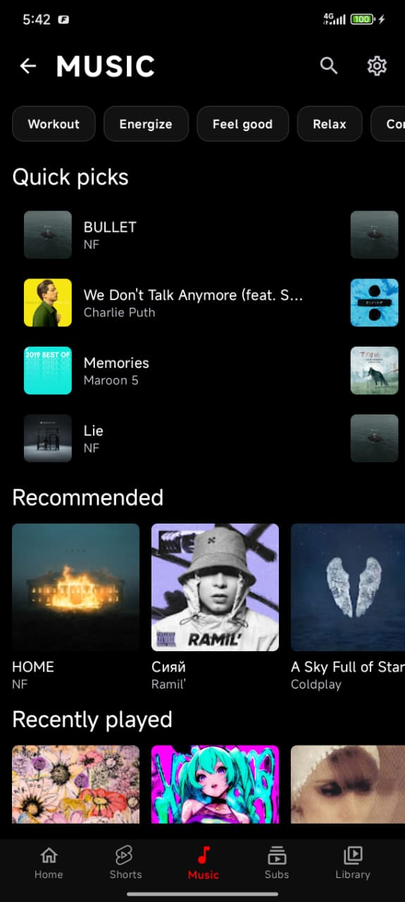
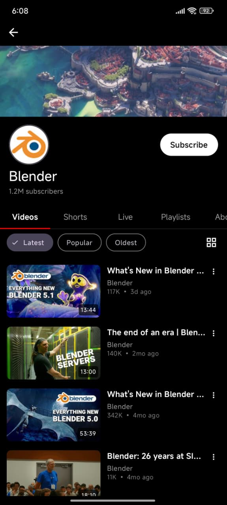

<div align="center">
  

  <h1>Flow Tube</h1>

  <h3>A privacy-first YouTube and YouTube Music client for Android, with recommendations that never leave your phone.</h3>

  <p>
    <a href="https://github.com/NETO-DEV66/Flow-tub/releases/latest"></a>
    <a href="https://github.com/NETO-DEV66/Flow-tub/releases"></a>
    <a href="License"></a>
    
    
  </p>

  <p>
    <a href="https://github.com/NETO-DEV66/Flow-tub/releases/latest"><b>Download APK</b></a> ·
    <a href="#build-from-source"><b>Build</b></a> ·
    <a href="privacy.md"><b>Privacy</b></a> ·
    <a href="CONTRIBUTING.md"><b>Contribute</b></a> ·
    <a href="SECURITY.md"><b>Security</b></a>
  </p>

  <p>
    <sub>Not affiliated with, endorsed by, or sponsored by Google LLC or YouTube. "YouTube" and
    "YouTube Music" are trademarks of Google LLC.</sub>
  </p>
</div>

---

## Why Flow Tube?

Most open-source YouTube clients give you playback but no way to discover new content. You either
use the official app and get tracked, or you use an alternative and lose recommendations entirely.

Flow Tube gives you both. A recommendation engine learns what you like by analysing your watch
behaviour **locally**. Nothing leaves your device. You can inspect everything it knows about you,
adjust it, or wipe it at any time.

---

## Features

### Video
- High-quality playback via ExoPlayer (Media3) with resolution switching (1080p, 720p, 480p, 360p)
- SponsorBlock — automatically skips sponsors, intros, outros, and filler
- DeArrow — replaces clickbait thumbnails and titles with community-sourced alternatives
- Return YouTube Dislike (RYD)
- Background playback — listen with the screen off
- Picture-in-Picture — keep watching while using other apps
- Casting to smart TVs and streaming devices
- Playback speed control (0.25x to 2x)
- Video chapters with seek jumping
- Gesture controls for brightness, volume, and seeking
- Subtitles with customisable font size, colour, and background
- Downloads with VP9, AV1, and standard format support
- Resume playback from where you left off

### Music
- Dedicated music player with album art and audio visualisations
- Queue management with add, remove, and reorder
- Shuffle and repeat (single/all)
- Persistent mini player across the app
- Synchronised lyrics display
- Fetches tracks from YouTube Music
- Playback speed control

### Recommendations (on-device engine)
- Runs 100% on-device — no server, no telemetry, no account needed
- Learns from what you watch, skip, like, dislike, and search for
- Distinguishes weekday and weekend patterns, morning and night preferences
- Detects when you're getting bored of a topic and mixes in new content
- Prevents your feed from collapsing into the same few topics
- Surfaces related videos from your recent watches to create natural topic transitions
- Uses engagement signals to filter out low-quality content
- Full transparency dashboard — see what the engine knows and why it recommended something
- Export/import your entire recommendation profile as a file

### Library
- Local watch history
- Favourites and custom playlists
- Shorts feed with bookmarking
- Continue watching shelf
- Subscription management with cached feeds

### Privacy
- No Google account required
- No ads, analytics, or tracking
- All data stored locally on your device
- Import subscriptions and history from NewPipe
- Export or delete everything at any time

### Appearance
- 11 themes: Light, Dark, OLED Black, Ocean Blue, Forest Green, Sunset Orange, Purple Nebula, Midnight Black, Rose Gold, Arctic Ice, Crimson Red
- Built entirely with Jetpack Compose and Material 3
- Multiple launcher icons, adaptive navigation rail, and a home-screen now-playing widget

---

## Screenshots

<div align="center">
  <table>
    <tr>
      <td align="center"><b>Home Feed</b><br></td>
      <td align="center"><b>Video Player</b><br></td>
      <td align="center"><b>Personality</b><br></td>
    </tr>
    <tr>
      <td align="center"><b>Music Player</b><br></td>
      <td align="center"><b>Music Hub</b><br></td>
      <td align="center"><b>Your Library</b><br></td>
    </tr>
    <tr>
      <td align="center"><b>Shorts</b><br></td>
      <td align="center"><b>Subscriptions</b><br></td>
      <td align="center"><b>Channel</b><br></td>
    </tr>
  </table>
</div>

---

## Download

Every release ships **one universal APK**. It contains both 32-bit and 64-bit ARM code, so it
installs on every supported device — there is no ABI to choose.

| APK | Size | Devices |
| :--- | :--- | :--- |
| `FlowTube-vX.Y.Z-universal.apk` | ~23 MB | Every supported phone and tablet |

Grab it from the [latest release](https://github.com/NETO-DEV66/Flow-tub/releases/latest), or let the
app update itself: it checks for a new release and installs it after you confirm.

### Requirements

**Minimum:** Android 8.0 (API 26) · **Tested up to:** Android 16 (API 36)

### Verify your download

Each release publishes a `checksums.txt` next to the APK. Compare it with the file you downloaded:

```bash
sha256sum -c checksums.txt
```

Every APK is signed with the same release key, so the signature stays identical across updates and
Android can install a new release over an older one. You can confirm it yourself:

```bash
apksigner verify --print-certs FlowTube-vX.Y.Z-universal.apk
```

The certificate's SHA-256 fingerprint is:

```
DF:F2:DC:23:A3:59:FA:73:2E:7C:38:C2:26:E4:C0:2F:7C:BE:21:9E:C6:C9:F7:FC:A7:E6:14:07:05:57:58:99
```

---

## Build from source

You need **JDK 21** and the **Android SDK** (platform `android-37.0`, build-tools `37.0.0`).
The project uses Gradle with a version catalogue in `gradle/libs.versions.toml`.

```bash
git clone https://github.com/NETO-DEV66/Flow-tub.git
cd Flow-tub

# Debug build
./gradlew :app:assembleGithubDebug

# Release build — the single universal APK
./gradlew :app:assembleGithubRelease
```

Output lands in:

```
app/build/outputs/apk/github/release/app-github-release.apk
```

One product flavour exists: `github` (in-app updater enabled). Always use flavour-prefixed tasks,
e.g. `assembleGithubDebug`, never bare `assembleDebug`.

### Signing the release build

A release APK is only installable as an update if it is signed with the same key as the previous
one. The build reads the key from **one** of these, in order of precedence:

1. Gradle properties — `-PstorePassword=… -PkeyAlias=… -PkeyPassword=…`
2. `key.properties` in the repository root
3. Environment variables — `STORE_PASSWORD`, `KEY_ALIAS`, `KEY_PASSWORD`

with the keystore itself at `release.keystore` in the repository root. If no keystore is present,
the build still succeeds but produces an **unsigned** APK.

```properties
# key.properties  (never commit this file)
storePassword=…
keyAlias=flowtube
keyPassword=…
```

Generate a fresh key once, then keep it somewhere safe — losing it means you can never ship an
update to an installed user again:

```bash
keytool -genkeypair -v \
  -keystore release.keystore -storetype PKCS12 -alias flowtube \
  -keyalg RSA -keysize 4096 -sigalg SHA384withRSA -validity 10000
```

### Tests and formatting

```bash
./gradlew :app:testGithubDebugUnitTest      # JVM unit tests (Robolectric for Compose UI)
./gradlew ktlintCheck                       # Spotless / ktlint formatting check
./gradlew ktlintFormat                      # auto-format Kotlin sources
```

Instrumentation tests are not executed in CI, but they must compile:

```bash
./gradlew :app:compileGithubDebugAndroidTestKotlin
```

---

## CI and releases

`.github/workflows/build.yml` builds the app, runs the unit tests, lints, signs, verifies the
signing certificate, and publishes the release. Pushing a `v*` tag publishes a GitHub release
carrying exactly one file pair: the universal APK and its checksums.

To let CI sign the APK, add these **repository secrets** (Settings → Secrets and variables →
Actions):

| Secret | Value |
| :--- | :--- |
| `RELEASE_KEYSTORE_BASE64` | `base64 -w0 release.keystore` |
| `STORE_PASSWORD` | keystore password |
| `KEY_ALIAS` | `flowtube` |
| `KEY_PASSWORD` | key password |
| `LASTFM_API_KEY` | *(optional)* Last.fm API key |
| `LASTFM_API_SECRET` | *(optional)* Last.fm API secret |

Optionally set the **repository variable** `EXPECTED_SIGNER_SHA256` to the certificate fingerprint
above. When set, CI fails the build if the APK is signed with a different key — which stops an
unrecoverable update-path mistake from ever being published. When it is empty the check is skipped.

```bash
# Publish a release
git tag v1.0.2 && git push origin v1.0.2
```

---

## Architecture

- **Language:** Kotlin, with Jetpack Compose and Material 3 for all UI
- **DI:** Hilt
- **Playback:** Media3 / ExoPlayer
- **Data:** Room (10 schema versions, 24 → 33) and DataStore
- **Extraction:** a native InnerTube client with a NewPipeExtractor fallback path
- **Widgets:** Glance (home-screen now-playing widget)

Source layout:

```
app/src/main/java/com/flowtube/app/
├── data/            repositories, Room, DataStore, extraction, downloads
├── player/          ExoPlayer wiring, PiP, popup, shorts
├── service/         media services and foreground playback
├── ui/              Compose screens, components, theme, TV shell
├── widget/          Glance widgets
└── util/            shared helpers
```

---

## Contributing

Contributions are welcome — bug reports, fixes, translations, and documentation. Please read
[CONTRIBUTING.md](CONTRIBUTING.md) and our [Code of Conduct](CODE_OF_CONDUCT.md) first.

For security issues, follow [SECURITY.md](SECURITY.md) instead of opening a public issue.

---

## Acknowledgements

Flow Tube is a rebranded fork of **[Flow](https://github.com/Flow-Tube/Flow)** (`io.github.aedev.flow`),
a GPL-3.0 Android YouTube and YouTube Music client. The upstream project and its authors retain the
copyright on the code this project derives from, and their notices are kept as the GPL requires.

It also builds on excellent open-source work:

- **[Flow](https://github.com/Flow-Tube/Flow)** — the upstream Android client this project is forked from.
- **[Flow Desktop](https://github.com/Flow-Tube/Flow-Desktop)** — the desktop counterpart whose sync format and recommendation model this app mirrors.
- **[NewPipeExtractor](https://github.com/TeamNewPipe/NewPipeExtractor)** — the fallback data extraction path.
- **[NewPipe](https://github.com/TeamNewPipe/NewPipe)** — inspiration for YouTube data handling.
- **[PipePipe](https://codeberg.org/NullPointerException/PipePipe)** — guidance on the SABR and InnerTube playback pipeline.
- **[Metrolist](https://github.com/MetrolistGroup/Metrolist)** — inspiration for hybrid music fetching and lyrics handling.
- **[LibreTube](https://github.com/LibreTube/LibreTube)** — inspiration for SponsorBlock and DeArrow handling.
- **[ExoPlayer](https://github.com/google/ExoPlayer)** — Android media playback.
- **[Jetpack Compose](https://developer.android.com/jetpack/compose)** and **[Material Design 3](https://m3.material.io/)** — the UI toolkit and design system.

---

## Disclaimer

Flow Tube is an independent, open-source client. It is **not affiliated with, endorsed by, sponsored
by, or approved by Google LLC or YouTube**. "YouTube" and "YouTube Music" are trademarks of Google LLC,
used here only to describe what the app can play.

The app ships no content of its own. Everything it streams or downloads comes from third-party services,
belongs to its respective owners, and is accessed at your own risk, subject to the terms of service of
the platform you use. Downloading content may be restricted by those terms in your region.

Screenshots in this README are for illustration only.

---

## License

Flow Tube is free software, distributed under the **GNU General Public License v3 (GPLv3)**. You may
use, study, share, and improve it.

This project is a rebranded fork of [Flow](https://github.com/Flow-Tube/Flow). The upstream code is
copyright © 2025-2026 the Flow authors, and that notice is retained as the GPL requires. Any project
that reuses this source must also be released as open source under the GPLv3 — you may not ship it in
a proprietary or closed-source application.

See [License](License) for the full text.
